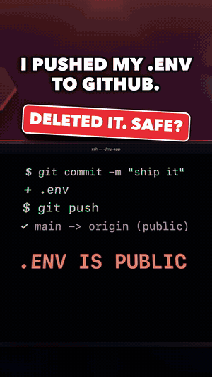
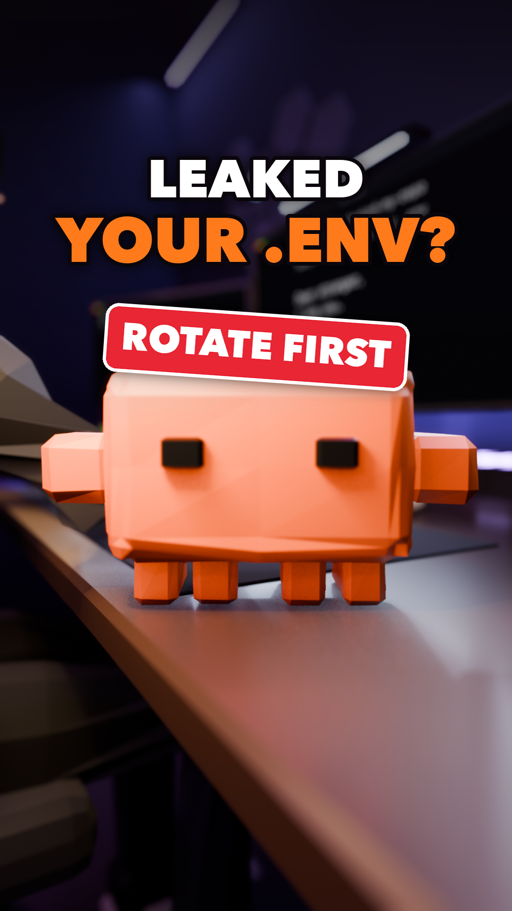
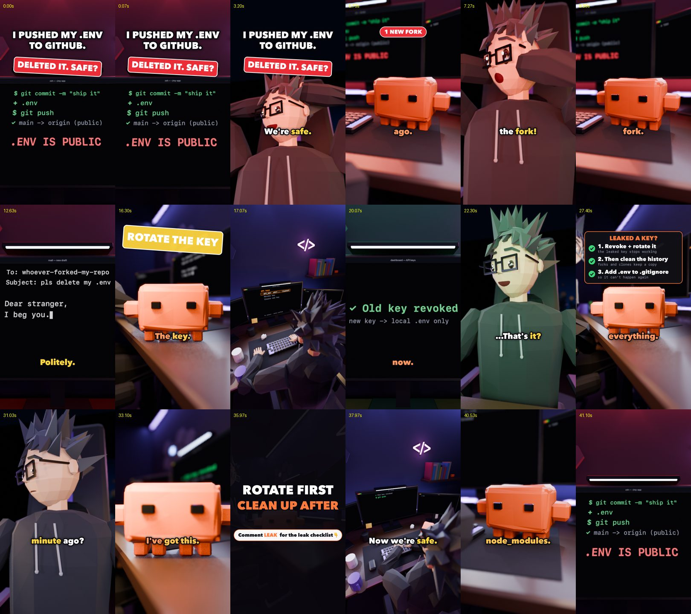

# reel-studio

**Make the orange-robot sketch reels you've seen on Instagram.** One `storyboard.json` in, a finished
9:16 reel out: two 3D characters, acting, cameras, monitors, subtitles, music, SFX, cover and a QA report.
Everything is procedural Blender driven by Claude Code. No AI image or video generation.

<p align="center">
  
  &nbsp;&nbsp;
  
</p>

This is the exact setup behind [@thedebugduo](https://www.instagram.com/thedebugduo/): the Nerd panics,
Claude (the orange robot on his desk) answers deadpan, slips in one real tip, and the last frame loops
back into the first. Watch the [".env" episode](https://www.instagram.com/reel/De-JRqviF1z/) made with
this repo.

⭐ **If this saves you a week of Blender work, star the repo.** It's how we know to keep publishing.

---

## What's inside

| | |
|---|---|
| [`skills/duo-sketch-reel/`](skills/duo-sketch-reel/) | The Claude Code skill: the Blender engine (set, both rigs, acting, lights, cameras, monitors), overlay, synthesized score and SFX, whisper alignment, render, cover and QA. |
| [`examples/`](examples/) | Two finished episodes: [`env-rotate`](examples/env-rotate/) (leaked `.env` → rotate the key) and [`caps-lock`](examples/caps-lock/) (the fix is on another port). Each has its `storyboard.json` and a `research.md` with every fact sourced. |
| [`playbook/`](playbook/) | What we learned growing the account: hooks, structure, retention numbers from our own reels, captions, and the comment-to-DM funnel. |
| [`setup/`](setup/) | `install.sh` checks the tools, makes the Python environment and installs the skill. |

## How a reel gets made

```
idea ─► research.md (sources) ─► storyboard.json (lines, shots, acting, screens, overlay)
     ─► free draft with macOS voices ─► stills at every beat end (fix the layout for free)
     ─► voice takes (ElevenLabs or your own mic) ─► whisper check
     ─► Blender EEVEE render ─► final.mp4 + final_b.mp4 (A/B hook) + cover.png + qa/report.md
```

A new episode is **data, not code**: lines, camera shots (`nerd_cu`, `claude_lens`, `monitor_ecu`…),
the Nerd's face/pose/hands, Claude's bounces and walks, what each monitor shows, overlay chips,
panels and stamps, lights and music changes. The schema is in
[`references/storyboard.md`](skills/duo-sketch-reel/references/storyboard.md).

<p align="center"></p>

## Quick start

**Requirements:** macOS on Apple silicon (tested), [Blender](https://www.blender.org/download/) 5.x,
`ffmpeg`, [whisper.cpp](https://github.com/ggerganov/whisper.cpp) (`whisper-cli`), Python 3 and
[Claude Code](https://claude.com/claude-code). Linux works if you point the environment variables at
your Blender binary and fonts (see the skill's "Files" section); the free `say` draft is macOS only.

```bash
git clone https://github.com/NaxFur/reel-studio.git
cd reel-studio
./setup/install.sh            # checks tools, creates ~/.venvs/duo-reel, links the skill into ~/.claude/skills
```

Render the example's layout stills (free, no voices needed on macOS):

```bash
skills/duo-sketch-reel/pipeline.sh examples/env-rotate --say stills
open examples/env-rotate/renders/stills/sheet.jpg
```

Then open Claude Code anywhere and ask:

> Make a Nerd + Claude sketch about forgetting to save the file before testing.

Claude follows the skill: researches the tip, writes the script and storyboard, runs the free draft,
checks the stills, generates the voices, renders and runs QA.

## Costs, honestly

- **Voices:** ≈ 1 ElevenLabs credit per character. Our 13-line episodes cost 745-839 credits. Record
  yourself and it's free.
- **Render:** ≈ 3 s per frame with 3 Blender workers on an M-series Mac: a 40 s reel takes about an hour.
- Everything else (music, SFX, overlay, captions, cover) is generated locally.

## Make them perform

Read the [playbook](playbook/README.md) before your first episode. Short version: the joke is about
**what the viewer does with their AI**, Claude is a character (not a teacher), one tip per episode,
30-40 seconds, and the last frame loops into the first.

For captions, hooks and the rest of the Instagram side we use
[instagram-agent-skill](https://github.com/Jakeschincariol/instagram-agent-skill) (MIT, not part of this repo).

## License and credits

Code: [MIT](LICENSE). The Nerd and the orange robot are drawn in code in this repo; use them, remix them,
make your own characters.

Not affiliated with or endorsed by Anthropic. "Claude" is a trademark of Anthropic, PBC; the robot is a
fan character in a comedy series. Blender is a trademark of the Blender Foundation.

Made by [@thedebugduo](https://www.instagram.com/thedebugduo/). New episode every day; follow to see
what the repo makes next.
